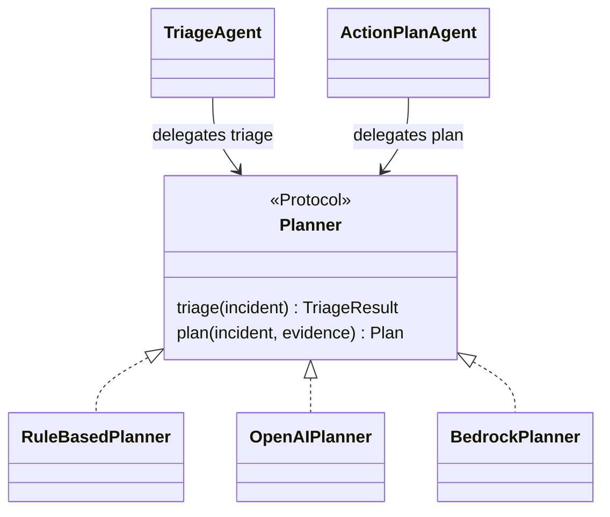
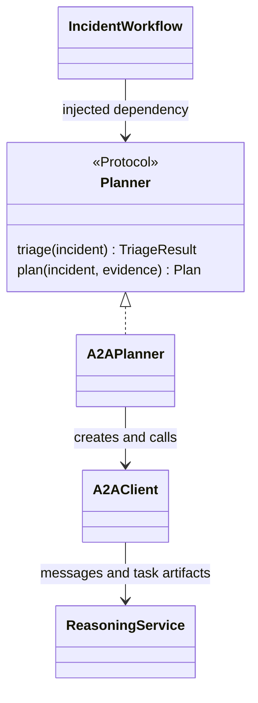

# Incident Agent

Python LangGraph baseline for DenDenMushi incident triage, evidence gathering,
approval-gated action planning, and constrained remediation.

This is the first concrete Phase 2 AI-agent baseline. It is intentionally
bounded: the model can classify, summarize evidence, and propose a structured
plan, but authority to mutate infrastructure or target hosts remains outside
the model and behind explicit validation plus human approval.

The coordinator consumes managed-server CloudWatch alarm notifications from
SQS, delegates structured triage and planning to a private Reasoning Agent over
A2A, gathers bounded diagnostics through a private MCP Tool Gateway, and stores
sanitized alert and incident metadata in Postgres. The Go
`agent-controlplane` exposes Cognito-protected approval pages plus JSON
endpoints for the Angular Agentic AI UI.

The model never receives authority to execute free-form shell commands.
Mutating operations come from the code-reviewed v1 remediation catalog, and one
catalog operation runs only after a human approves the exact stored plan hash.
Live terminal traffic remains direct
between the browser, Proxy Dataplane, and target host; the incident agent never
proxies interactive terminal streams.

## Configuration

```text
PORT=8091
INCIDENT_AGENT_COMPONENT=coordinator
SERVICE_NAME=incident-agent
LOG_FORMAT=json
AWS_REGION=ap-southeast-1
ENVIRONMENT=dev
CLOUDWATCH_NAMESPACE=DenDenMushi
INCIDENT_QUEUE_URL=
DATABASE_URL=
DATABASE_SECRET_ID=
AGENT_CONTROLPLANE_URL=http://agent-controlplane:8092
REASONING_AGENT_URL=http://incident-reasoning-agent:8093
TOOL_GATEWAY_URL=http://agent-tool-gateway:8094/mcp
STS_URL=http://sts:8082
TOOL_POLICY_FILE=
PROXY_CONTROLPLANE_URL=http://proxy-controlplane:8080
WORKLOAD_TOKEN_FILE=/var/run/secrets/tokens/incident-agent-token
PLANNER_MODE=openai_with_fallback
OPENAI_MODEL=gpt-5.4-2026-03-05
OPENAI_AUTH_MODE=aws_iam
OPENAI_GATEWAY_URL=
OPENAI_GATEWAY_TARGET=openai
OPENAI_AWS_REGION=ap-southeast-1
OPENAI_REASONING_EFFORT=low
OPENAI_MAX_OUTPUT_TOKENS=4096
OPENAI_TIMEOUT_SECONDS=60
OPENAI_API_KEY=
BEDROCK_REGION=us-east-1
BEDROCK_MODEL_ID=global.amazon.nova-2-lite-v1:0
BEDROCK_FALLBACK_ENABLED=true
BEDROCK_MAX_PROMPT_BYTES=131072
INCIDENT_AGENT_PROMPTS_DIR=
HTTP_TIMEOUT_SECONDS=10
TRANSIENT_RETRY_ATTEMPTS=2
OPERATION_TIMEOUT_SECONDS=45
MAX_OPERATION_OUTPUT_BYTES=262144
SQS_POLL_WAIT_SECONDS=20
SQS_VISIBILITY_TIMEOUT_SECONDS=600
INCIDENT_CLAIM_LEASE_SECONDS=120
INCIDENT_CLAIM_RENEW_SECONDS=30
ENABLE_SQS_CONSUMER=true
LANGSMITH_TRACING=false
LANGSMITH_API_KEY_SECRET_ID=
LANGSMITH_PROJECT=
LANGSMITH_ENDPOINT=
LANGSMITH_WORKSPACE_ID=
```

`DATABASE_SECRET_ID` must contain the raw Postgres connection URL. Prefer it to
`DATABASE_URL` in EKS. The service accepts `postgres://`, `postgresql://`, and
`postgresql+psycopg://` URLs, normalizing them to the bundled `psycopg` driver
before opening the SQLAlchemy engine.

When `LANGSMITH_TRACING=true`, the Reasoning Agent reads `LANGSMITH_API_KEY` from the
environment or fetches it from `LANGSMITH_API_KEY_SECRET_ID` in AWS Secrets
Manager before constructing the LangChain Bedrock client. If no key is
available, tracing is disabled and the worker continues so incident processing
is not blocked by optional observability. The API key, secret ID, prompts, model
responses, and diagnostic output are not logged.

Planner prompt templates live under the repository root `prompts/` directory.
`INCIDENT_AGENT_PROMPTS_DIR` may point at another template directory for local
experiments or environment-specific packaging; if unset, the service resolves
the root `prompts/` directory and the Docker image copies it to `/app/prompts`.
`PLANNER_MODE` controls model usage. Dev uses the IAM-authenticated AgentCore
inference gateway and pinned `gpt-5.4-2026-03-05` with deterministic fallback:

- `bedrock_with_fallback`: Bedrock first, then deterministic fallback on
  provider invocation failure.
- `bedrock`: Bedrock only.
- `openai_with_fallback`: OpenAI Responses API first, then deterministic
  fallback on provider invocation failure.
- `openai`: OpenAI Responses API only.
- `rule_based`: deterministic triage and planning, no LLM calls.

Provider modes and model IDs are code allowlisted before a provider client is
constructed. `OPENAI_AUTH_MODE=aws_iam` signs every request for service
`bedrock-agentcore` with the current IRSA credentials. The Terraform gateway
URL ends in `/mcp`; the client removes that MCP suffix and sends inference to
`/inference/v1/responses`. The gateway route is
`openai/gpt-5.4-2026-03-05`. The pod has `InvokeGateway` permission but no
permission to read the OpenAI secret. `OPENAI_AUTH_MODE=api_key` remains
available for local development and is the only mode that requires
`OPENAI_API_KEY`. Never put an API key in this README, Kustomize overlays,
Terraform variables, shell history, or committed manifests.

OpenAI requests use `reasoning.effort=low`, low text verbosity,
`max_output_tokens=4096`, `store=false`, a 60-second provider timeout, and at
most two attempts. The dedicated OpenAI project is intentionally opted into
input/output sharing for complimentary usage. `store=false` disables Responses
API application storage for these calls; it does not override that project
sharing choice. Prompts and evidence therefore remain redacted, bounded, and
free of credentials or terminal streams.

`BEDROCK_REGION` overrides only the compatibility Bedrock runtime client region. Leave
`AWS_REGION` set to the deployment region for SQS, Secrets Manager, and other
AWS dependencies. `global.amazon.nova-2-lite-v1:0` in `us-east-1` is the
configured Bedrock model for dev; if the Nova quota was requested in another
region, set `BEDROCK_REGION` to that region before rollout.
The deployed OpenAI fallback mode handles availability errors such as throttling, quota
exhaustion, and network failures by using the deterministic `RuleBasedPlanner`.
It never falls back to Bedrock or Nova. Bedrock modes and `gpt-5.5` remain in
the reviewed compatibility allowlists but are not selected by the dev workload.
Invalid model JSON, oversized prompts, and plan validation failures still fail
the incident because those are correctness or safety failures, not provider
availability failures.

CloudWatch alarm descriptions must be JSON:

```json
{"source":"managed-server","hostId":"host-dev-1","runbookVersion":"v1"}
```

Only alarms with `source=managed-server` are turned into alert and incident
records. Other CloudWatch alarms delivered to the central queue are
acknowledged and ignored so DenDenMushi platform alarms do not appear in the
managed-server alert inbox.

Target host Terraform should pass the DenDenMushi
`incident_alerts_topic_arn` output into its alarm actions so target ALARM/OK
transitions land in the central incident queue.

## Multi-Agent Workflow

```text
SQS alert
-> Incident Manager Agent
-> Reasoning Agent over A2A for structured triage
-> Evidence Collector Agent through the MCP Tool Gateway
-> Reasoning Agent over A2A for a structured single-action candidate plan
-> Action Plan Reviewer Agent with deterministic guardrails and plan hash
-> await human approval
-> Agent Control Plane through the MCP Tool Gateway for the approved operation
-> verify service_status and health_check
-> close automation run
```

The coordinator and Reasoning Agent are separate private workloads using the
official A2A Python SDK. Authenticated `GET /.well-known/agent-card.json` advertises one
`analyze_incident` skill and `POST /` accepts A2A JSON-RPC for the `triage` and
`plan` stages. A2A task state is disposable; Postgres remains authoritative.
The Reasoning Agent has no database, SQS, Kubernetes, or operation permissions.

The Tool Gateway is an official Streamable HTTP MCP server at `/mcp`. It
filters `tools/list` by projected workload identity and accepts only `runId`
plus `planHash` where required. The GitOps policy defaults to deny. The
coordinator can discover diagnostics; Agent Control Plane can discover the
reviewed remediation catalog and fixed verification tools; the Reasoning Agent
has no tools. Commands, addresses, credentials, URLs, and arbitrary arguments
are never accepted. The model proposes, deterministic code reviews,
Manager/Admin users approve, and fresh STS capabilities authorize execution.

Allowed diagnostic operations:

```text
system_overview
disk_usage
memory_usage
top_processes
service_status
service_logs
health_check
target_probe
```

Allowed v1 remediation operations:

```text
restart_service
recover_demo_app
reload_service
```

The deterministic supervisor rejects unknown tools, command-like plan content,
plan hash drift, missing approval, multiple remediation actions, and execution
outside the v1 remediation catalog.

Each incident stores safe explainability metadata in `explanation_json`: model
provider/type/ID, region and safe gateway route, prompt template hashes, catalog version,
named agent roles, reasoning types, memory scope, tools, inputs, outputs,
handoffs, diagnostic and verification operation IDs, tool-selection reasons,
guardrail outcomes, and responsibility boundaries. It intentionally excludes
rendered prompts, model responses, tokens, command bodies, secrets, and
terminal streams.

The append-only `incident_events` stream is also the source of truth for the
versioned action trace returned by Agent Control Plane. Every A2A triage and
plan attempt records an `AgentDelegated` event with stage, actor boundary,
protocol, duration, outcome, and fallback flag. Every diagnostic attempt
records an `OperationExecuted` event with phase, operation ID, selection
authority, duration, status, exit code, truncation, and a SHA-256 digest of the
already bounded/redacted result. Failed calls are persisted before workflow
failure handling, and provider fallback is recorded explicitly rather than
presented as model success. These event records contain safe summaries only;
they never store prompts, provider reasoning, tokens, command bodies,
unrestricted tool arguments, or raw diagnostic output.

## Observability

Production observability is AWS-native by default. The service emits JSON logs
when `LOG_FORMAT=json`, propagates `X-Request-ID` on HTTP requests, creates a
correlation ID for each SQS message, and writes CloudWatch EMF metrics to
stdout in `CLOUDWATCH_NAMESPACE`.

Metrics use low-cardinality dimensions only (`Service` is the active component
name and `Environment` identifies the environment). Log fields are metadata such as `requestId`, `incidentId`,
`runId`, `hostId`, `operation`, `planHash`, `state`, `durationMs`, and
`errorKind`; prompts, model responses, tokens, command bodies, diagnostic
stdout/stderr, and terminal streams must not be logged.
Claim lifecycle signals are `IncidentClaimContended`,
`IncidentClaimReclaimed`, and `IncidentClaimLost`; SQS heartbeat failures emit
`SQSVisibilityExtensionFailures` without adding high-cardinality dimensions.

LangSmith can be enabled for local or staging metadata tracing with
`LANGSMITH_TRACING=true`; the dev Kubernetes overlay wires the API key only to
the Reasoning Agent through AWS Secrets Manager. The OpenAI planner explicitly
traces each triage/plan stage, provider attempt and schema validation; a
deterministic fallback is a separate trace correlated by incident ID and stage.
Only allowlisted identifiers, model IDs, prompt-template hashes, duration,
usage and outcomes are exported. Inputs and outputs are empty; raw prompts,
evidence, responses, headers and exceptions are excluded. SDK runtime-environment
capture is disabled. LangSmith adds its own trace-depth metadata.

The optional exporter has a 128-span queue, one daemon worker, no retries,
1-second connection / 2-second read timeouts and a 5-second shutdown join.
Missing/unreadable credentials disable tracing. Export failures and a full queue
discard telemetry without changing model results, fallback decisions or approval
requirements. This is best-effort observability: application audit events remain
the record for A2A, diagnostics, review, approval, execution and verification.
`LANGSMITH_HIDE_INPUTS` and `LANGSMITH_HIDE_OUTPUTS` are set when enabled.
Production keeps tracing disabled. Bedrock invocation logging
and OpenTelemetry/X-Ray tracing should also remain disabled by default because
they can retain sensitive prompt or evidence data; enable them only for short,
explicit debug windows.

R10's controlled replay verified two roots / six spans in the dev project on
7 October 2026, with empty exported inputs/outputs and unchanged 14-day base
retention. This verified local Reasoning Agent code through the configured
IAM-authenticated AgentCore route; it did not deploy the changes or execute
remediation. Screenshots and readback evidence are in
`../documentation/R10_R16_MODEL_EVIDENCE.md`.

SQS failures are left for normal queue redelivery and DLQ handling. Inspect the
Terraform-created DLQ when `SQSMessageFailures` alarms, fix the parser or
upstream alarm description, then replay messages by redriving them from the DLQ.

Alert rows store sanitized metadata only: source identifiers, managed-server
source type, alarm ARN/name, CloudWatch state, host ID, reason, status,
group key, linked incident ID, grouped flag, error summary, and timestamps.
Raw SNS/SQS payloads are not retained.

`PlanValidationFailed` timeline events are metadata-only and record validation
failure class names, not raw model output or rejected command-like text.

The deterministic `groupKey` (`sourceType|hostId|alarmName`) suppresses duplicate
active agent runs. Postgres atomically permits only one active incident per
non-empty group key. A managed-server `ALARM` for the same active group links to
the existing incident and records an `AlertGrouped` timeline event instead of
starting another workflow. The alert row is still retained for operator
visibility.

Diagnosis ownership uses an opaque, renewable, per-process fenced lease. A
same-source SQS redelivery is not acknowledged while another live owner holds
the claim. After expiry, a worker can reclaim the incident, emit
`IncidentProcessingReclaimed`, and restart read-only diagnosis from the
beginning. Every diagnosis state write checks the new claim token, so an old
worker cannot overwrite the replacement. The SQS consumer also extends message
visibility while work is in progress. It receives one message at a time and,
when another worker owns the claim, shortens that message's visibility to the
configured claim-renew interval without acknowledging it. Managed-server `OK`
alerts clear any diagnosis claim, recover matching active incidents, and
record recovery timeline metadata.

This ownership path intentionally does not use a vector store. Embedding
similarity is not a concurrency primitive and cross-incident model memory is
outside the current bounded-agent scope.

Alert statuses:

```text
RECEIVED -> TRIAGING -> PENDING_APPROVAL -> EXECUTING -> RESOLVED
RECEIVED -> TRIAGING -> TRIAGED
RECEIVED -> TRIAGING -> FAILED
PENDING_APPROVAL -> REJECTED
```

`AGENT_CONTROLPLANE_URL` is used for automation-run lifecycle and state-aware
capability requests. Operation execution always uses `TOOL_GATEWAY_URL`.
`PROXY_CONTROLPLANE_URL` remains only as a local compatibility fallback for the
control-plane address and is not an operation path.

## Routes

```http
GET  /healthz
GET  /readyz
GET  /openapi.yaml
GET  /internal/worker/health
```

Private protocol routes use separate component processes from the same image:

```http
GET  /.well-known/agent-card.json  # Reasoning Agent, port 8093
POST /                             # A2A JSON-RPC, port 8093
POST /mcp                          # MCP Streamable HTTP, port 8094
```

Every A2A and MCP request carries a projected service-account token validated
through STS TokenReview. Authentication, validation, policy, stale-state, and
plan-hash failures fail closed. Only bounded transient A2A/provider failures
fall back to the deterministic planner. Diagnostics and verification allow one
transient transport retry; remediation is never retried automatically.

Business endpoints require `x-api-version: 1`. `GET /healthz`, `GET /readyz`,
and `GET /openapi.yaml` are exempt so probes and spec reads do not need custom
headers.
Successful probe access logs are suppressed; failed probe responses still emit
access logs.

Public Agentic AI routes now live in `agent-controlplane`:

```http
GET  /agentic-ai/health
GET  /alerts
GET  /alerts/{alertId}
GET  /incidents
GET  /incidents/{incidentId}
POST /incidents/{incidentId}/approve
POST /incidents/{incidentId}/reject
```

`/internal/worker/health` returns safe worker status for agent-controlplane:
database readiness, queue consumer configured/running flags, last processed
alert time, last sanitized error summary, and active/failed incident counts. It
intentionally omits raw payloads, automation operation URLs, capability tokens,
secrets, prompts, and terminal streams.

Proposed plans expire 30 minutes after `PlanProposed`. Approve/reject attempts
after expiry return `409` and are recorded in the approval audit. All approval
attempts are retained as sanitized metadata, including successful decisions,
manager/admin authorization failures, stale plan hashes, missing incidents, and
expired plans.

## GoF Design Patterns

Two existing implementations demonstrate patterns from the Gang of Four catalogue.
The pattern names describe current code; they do not introduce new runtime behavior.

### Strategy — interchangeable incident planners

`Planner` in `src/incident_agent/planning/planner.py` is the strategy contract:
`triage(Incident) -> TriageResult` and
`plan(Incident, list[OperationResult]) -> Plan` are asynchronous operations.
`TriageAgent` and `ActionPlanAgent` are the contexts: they receive a planner by
constructor injection and delegate to it. `IncidentWorkflow` wires these contexts.
`RuleBasedPlanner`, `OpenAIPlanner`, and `BedrockPlanner` supply different algorithms
behind the same interface. Python structural typing provides the contract without
requiring each implementation to inherit from `Planner`.



The composition code in `main.py::_build_planner` selects the reasoning-service
implementation from reviewed configuration. The coordinator separately injects
`A2APlanner`, described below. This is startup selection, not an autonomous model
router. `FallbackPlanner` composes a primary and fallback planner and catches
provider invocation failures; invalid structured output and policy rejection do
not become permission to bypass review.

The benefit is that workflow code and tests can use a different planning algorithm
without duplicating the workflow. The cost is maintaining common result schemas
and handling provider-specific failures; interchangeable interfaces do not imply
equal diagnosis quality, latency, or cost. Every candidate plan still goes through
the deterministic reviewer and exact-plan human approval before mutation.

### Adapter — local planner calls over A2A

`A2APlanner` in `src/incident_agent/planning/a2a_client.py` is an object adapter.
Its target interface is `Planner`; the adapted interface is the A2A SDK client and
the remote reasoning service's message/task/artifact protocol. The workflow calls
ordinary domain methods without handling discovery, JSON-RPC or streamed artifacts.



For example, `A2APlanner.triage` sanitizes an incident, adds `stage="triage"`, and
uses `_send` to construct a `SendMessageRequest` containing a data message. `_send`
uses authenticated discovery, reads task/artifact/status events and converts a
structured artifact into a dictionary. `triage` validates it as `TriageResult`;
`plan` similarly returns a validated `Plan`. The client is closed in a `finally`
block. Availability failure may select the injected rule fallback, while rejected
tasks, wrong identity and invalid results remain failures.

The interface conversion makes this an Adapter: it is more than a same-interface
remote forwarding proxy. It also participates in the Strategy contract, but the
two patterns solve different problems: choosing an algorithm versus translating
an incompatible protocol. The benefit is isolating transport details from domain
workflow code. The cost is serialization, network latency, SDK compatibility work
and error classification; the adapter is not the authorization authority.

### Existing verification

`tests/test_main.py` checks configuration-based strategy construction and reviewed
model restrictions. `tests/test_rule_based_planner.py` and
`tests/test_planner_prompts.py` exercise deterministic results, provider payloads
and bounded fallback with fakes. `tests/test_a2a_protocol.py` checks authenticated
structured handoff, wrong-identity denial, availability-only fallback and sanitized
payloads using an in-process app and mocked transport. These are local contract
tests, not measured LLM accuracy or proof of a live deployment.

## Development

The Python import namespace remains `incident_agent`, with implementation
grouped into domain subpackages:

```text
incident_agent.api          HTTP routes and approval pages
incident_agent.automation   DenDenMushi automation client
incident_agent.ingest       CloudWatch/SQS alert ingestion
incident_agent.persistence  incident storage
incident_agent.planning     prompts, Bedrock planning, LangGraph workflow, guardrails
```

```bash
uv sync
uv run pytest
uv run ruff check .
uv run ruff format --check .
uv run mypy
uv run bandit -r src -q
uv run pip-audit
```

Run the focused transactional claim test against a migrated disposable
Postgres database:

```bash
INCIDENT_TEST_DATABASE_URL=postgresql://... make test-postgres
```

Production schema changes run through the `incident-agent-migrate` Argo CD
PreSync job before the Deployment rolls out. The image contains Alembic and can
also be migrated explicitly with either `DATABASE_URL` or
`DATABASE_SECRET_ID` configured:

```bash
uv run python -m incident_agent.migrate
```

Application startup never creates or changes tables. The migration entrypoint
upgrades versioned and empty databases normally. For the original unversioned
production schema, it first requires the complete revision 0004 table, column,
primary-key, and source-ID uniqueness signature; recreates only the known
baseline indexes omitted by the legacy `create_all` path; stamps revision 0004;
then upgrades and verifies revision 0005, the claim columns, and the partial
unique active-group index. Unknown, incomplete, or partially upgraded schemas
fail closed without logging database URLs, row values, or group keys.

Run locally with a direct database URL and SQS disabled:

```bash
DATABASE_URL=sqlite:///./incident-agent.db \
ENABLE_SQS_CONSUMER=false \
uv run incident-agent
```

## Evaluation Baseline

The original three fixtures remain regression tests. R12 adds a versioned
12-scenario corpus in `evals/fixtures/six_role_v1.json`, 25 Python role/category
cases, and five matching Go Agent Control Plane executor cases. Boundary tests
cover A2A/MCP authorization, real local Postgres claims/fencing, provider
failures, and dataplane ownership. Ordinary `pytest` never invokes an LLM.

Run from this repository, choosing a **new** output directory each time:

```bash
uv run python -m evals.runner --mode deterministic --output /tmp/r12-rules-001
INCIDENT_TEST_DATABASE_URL=postgresql://postgres@127.0.0.1:5432/r12 \
  uv run python -m evals.contracts --output /tmp/r12-contracts-001
uv run python -m evals.runner --mode gateway --repetitions 3 \
  --aws-profile capstone --output /tmp/r12-gateway-001
```

The contract runner requires the sibling `agent-controlplane` and
`proxy-dataplane` checkouts and Go. Use only a disposable local database;
migration tests are destructive to that test database. Missing or skipped
dependencies are recorded as blocked, not passed. The corpus has fixed
engineering expectations, not human ground-truth labels or judge scores.

Gateway mode is opt-in. It uses the production IAM-signing planner and the
existing `openai/gpt-5.4-2026-03-05` AgentCore route, with synthetic incident
data and simulated tools. `OPENAI_GATEWAY_URL` may specify the gateway; otherwise
the runner reads its non-secret URL from the dev overlay. No API key is read.
Runs disable LangSmith tracing, use one concurrent call, at least 10.1 seconds
between HTTP attempts, a 60-second timeout, two attempts per stage, and a
144-attempt ceiling. Authentication/configuration failures stop the campaign.
Use `--cases R12-S01,R12-S07` only for explicitly labelled partial reruns.

Artifacts contain source/corpus/prompt/catalog hashes, revisions and dirty
state, sanitized expected/actual outputs, verdicts, per-stage fallback and
attempt counts. They exclude transport headers, raw provider envelopes and
terminal streams. Stage durations include request pacing; they are not model
latency benchmarks. Output directories cannot be reused. A gateway campaign
with fallback is not reported as a complete primary-model campaign.

Measured on 7 October 2026: 72/72 gateway stages passed across 12 scenarios and
three repetitions, with no fallback; the corrected rule baseline passed 24/24.
All 30 role/category cases passed. Full results, initial failures and source
manifests are in `../documentation/R12_SIX_ROLE_EVALUATION.md`.

R12 regression fixes keep fallback conservative: whole-word service state
matching distinguishes `inactive` from `active`; only current `service_status`
and `health_check` stdout with non-transport-failure exit codes can justify a
rule-based repair. General logs and diagnostic transport errors cannot trigger
one. OpenAI authorization/configuration errors and malformed responses fail
without retry/fallback; transient HTTP 408/429/5xx and transport failures retain
bounded fallback. Failed diagnosis closes its automation run best-effort before
propagating the failure; run TTL remains the fallback if close is unavailable.

### R16 small model comparison

Run the frozen ten-case pilot through the configured IAM gateway:

```bash
PYTHONPATH=src uv run python -m evals.model_comparison \
  --aws-profile capstone --trace-evidence \
  --output ../documentation/evidence/r10-r16/NEW-RUN-ID
```

Use a new output directory. The runner refuses to overwrite an earlier run.
The configuration pins `gpt-5.4-2026-03-05` and `gpt-5.5-2026-04-23`; each gets
20 sequential calls (ten cases × triage/plan), low reasoning, 4,096 output tokens,
60-second timeout and at least 10.1 seconds between request starts. Scored runs
have one attempt and no fallback. The rules baseline runs separately without
provider calls. Mocked outage tests verify fallback separately.

Each request reserves a conservative maximum list-price estimate on disk before
sending. Known usage reconciles the reservation; timeouts, HTTP errors and missing
usage retain it. The hard USD5 ceiling includes traced comparison calls. This is
a per-campaign ceiling: do not launch simultaneous or additional campaigns against
a shared spending allowance. Refresh `PRICES` and official model-page references
before a new live campaign; complimentary usage is not assumed.

`--trace-evidence` reads the existing dev Secrets Manager reference in
`ap-southeast-1`, checks visible current-month root counts, and traces only the
two GPT-5.4 R12-S01 stages (six spans). Also check the billing UI for deleted or
not-yet-indexed usage. The runner does not upgrade retention, run hosted evaluators,
create annotation queues or submit more than two roots. Without this flag it
disables tracing. Results include sanitized structured outputs, expected verdicts,
failures, usage, latency, model IDs, source hashes and a durable budget ledger.

The 7 October pilot cost an estimated USD0.1417725 across 40 successful calls.
See `../documentation/R10_R16_MODEL_EVIDENCE.md` for the compact comparison,
representative disagreement, caveats and reproduction evidence.
